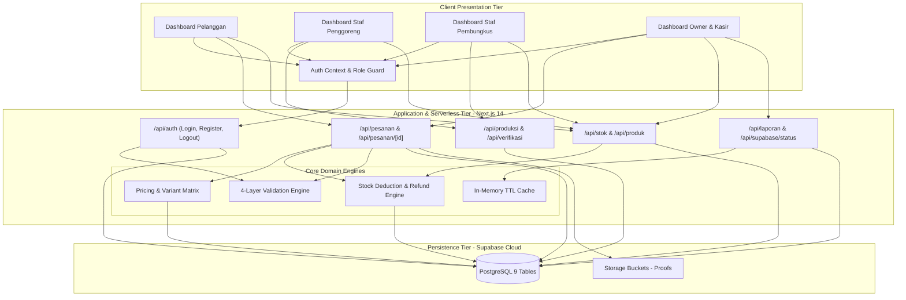
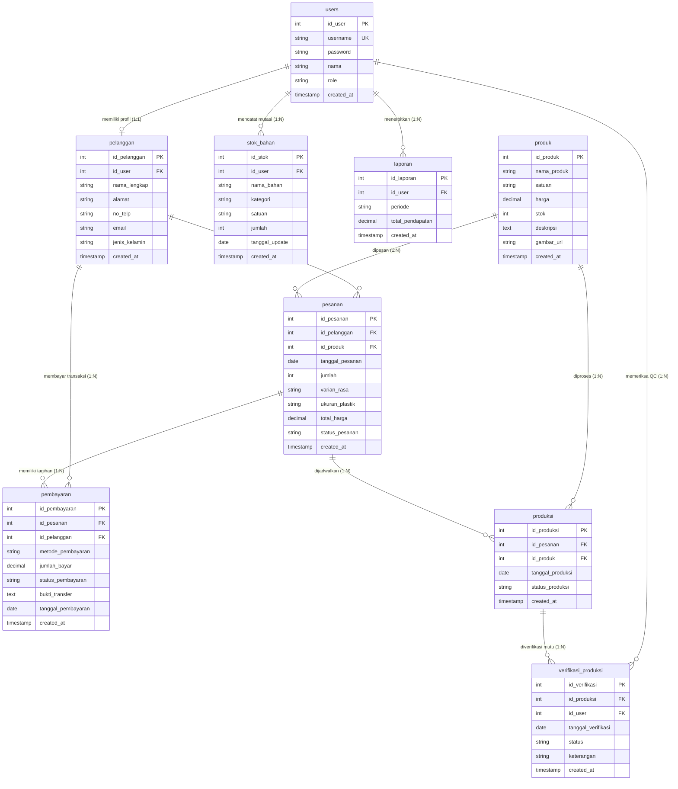
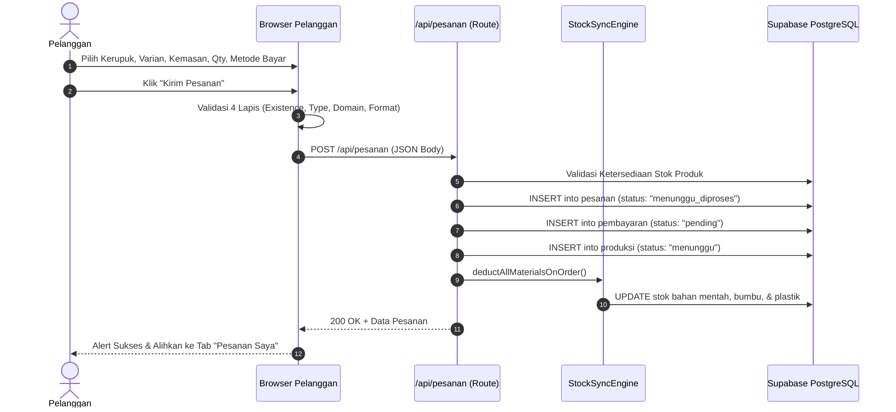
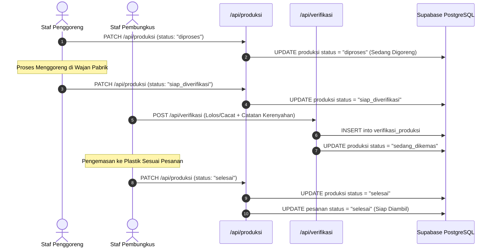
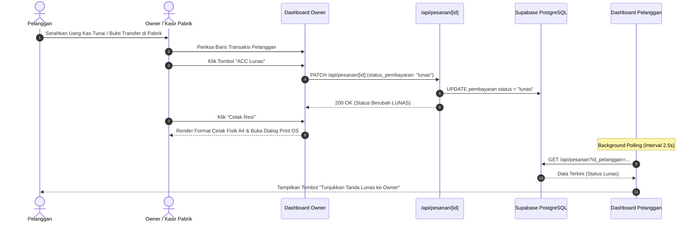
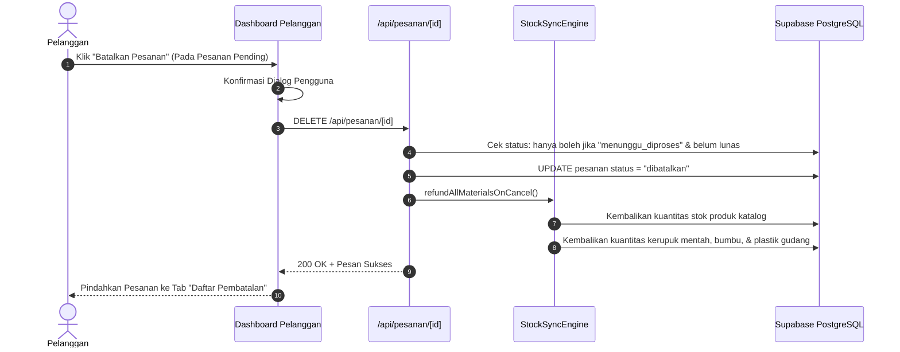
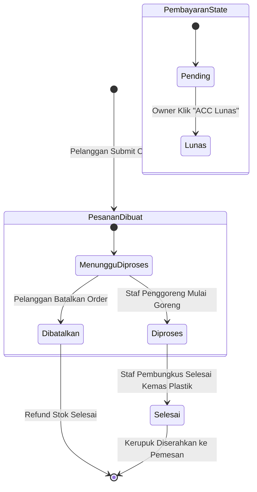
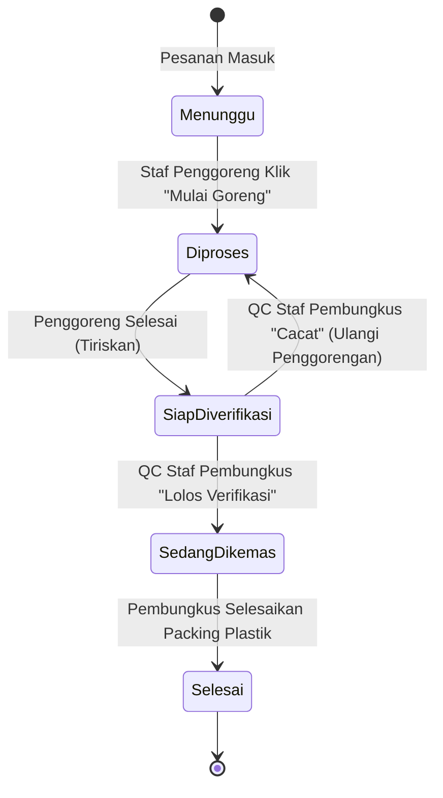
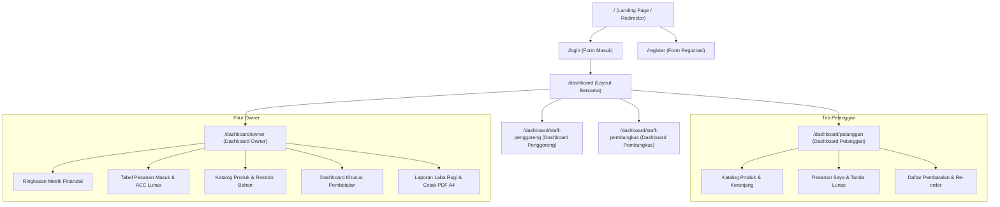

# DESKRIPSI PERANCANGAN PERANGKAT LUNAK (SOFTWARE DESIGN DESCRIPTION - SDD)
## Sistem Informasi Pemesanan dan Manajemen Produksi Kerupuk Berbasis Web (E-KRUPSY)
### Studi Kasus: Pabrik Kerupuk Diansyah — Sumedang

---

| Dokumen | Deskripsi Perancangan Perangkat Lunak (SDD) |
|---|---|
| **Aplikasi** | E-KRUPSY (*Electronic Kerupuk System*) |
| **Instansi / Mitra** | Pabrik Kerupuk Diansyah (Sumedang, Jawa Barat) |
| **Versi Dokumen** | 2.0 (Pemutakhiran Arsitektur & Sinkronisasi Kode Sumber) |
| **Tanggal Pemutakhiran** | 10 November 2026 |
| **Standar Acuan** | IEEE Std 1016-2009 (*IEEE Standard for Information Technology — Systems Design — Software Design Descriptions*) |
| **Status Dokumen** | Disetujui & Terverifikasi dengan Kode Sumber Sistem |

---

## DAFTAR ISI

- [BAB I: PENDAHULUAN](#bab-i-pendahuluan)
  - [1.1 Tujuan Dokumen](#11-tujuan-dokumen)
  - [1.2 Ruang Lingkup Perancangan](#12-ruang-lingkup-perancangan)
  - [1.3 Definisi, Istilah, dan Akronim](#13-definisi-istilah-dan-akronim)
  - [1.4 Referensi Desain](#14-referensi-desain)
- [BAB II: ARSITEKTUR SISTEM (SYSTEM ARCHITECTURE DESIGN)](#bab-ii-arsitektur-sistem-system-architecture-design)
  - [2.1 Gaya Arsitektur Sistem](#21-gaya-arsitektur-sistem)
  - [2.2 Diagram Arsitektur Tingkat Tinggi](#22-diagram-arsitektur-tingkat-tinggi)
  - [2.3 Dekomposisi Sistem Tiga Lapis (Three-Tier Decomposition)](#23-dekomposisi-sistem-tiga-lapis-three-tier-decomposition)
  - [2.4 Strategi Sinkronisasi Real-Time & Caching](#24-strategi-sinkronisasi-real-time--caching)
- [BAB III: DEKOMPOSISI SUBSISTEM & STRUKTUR MODUL (MODULE DESIGN)](#bab-iii-dekomposisi-subsistem--struktur-modul-module-design)
  - [3.1 Struktur Direktori Proyek](#31-struktur-direktori-proyek)
  - [3.2 Subsistem Antarmuka Pengguna (UI Presentation Hierarchy)](#32-subsistem-antarmuka-pengguna-ui-presentation-hierarchy)
  - [3.3 Subsistem Logika Bisnis & Utilitas Terpusat](#33-subsistem-logika-bisnis--utilitas-terpusat)
- [BAB IV: RANCANGAN ANTARMUKA KOMPONEN & API (INTERFACE & API DESIGN)](#bab-iv-rancangan-antarmuka-komponen--api-interface--api-design)
  - [4.1 Spesifikasi REST API Endpoints](#41-spesifikasi-rest-api-endpoints)
  - [4.2 Skema Payload Pertukaran Data](#42-skema-payload-pertukaran-data)
  - [4.3 Mekanisme Otorisasi Rute (RoleGuard)](#43-mekanisme-otorisasi-rute-roleguard)
- [BAB V: RANCANGAN BASIS DATA (DATA DESIGN & PERSISTENCE)](#bab-v-rancangan-basis-data-data-design--persistence)
  - [5.1 Entity-Relationship Diagram (ERD)](#51-entity-relationship-diagram-erd)
  - [5.2 Physical Data Model (PDM) & Kamus Data](#52-physical-data-model-pdm--kamus-data)
  - [5.3 Integritas Referensial & Skema Relasi](#53-integritas-referensial--skema-relasi)
- [BAB VI: RANCANGAN DINAMIS & PERILAKU SISTEM (DYNAMIC & BEHAVIORAL DESIGN)](#bab-vi-rancangan-dinamis--perilaku-sistem-dynamic--behavioral-design)
  - [6.1 Sequence Diagram: Alur Pemesanan & Pembayaran Multi-Channel](#61-sequence-diagram-alur-pemesanan--pembayaran-multi-channel)
  - [6.2 Sequence Diagram: Alur Produksi Dapur & Verifikasi QC](#62-sequence-diagram-alur-produksi-dapur--verifikasi-qc)
  - [6.3 Sequence Diagram: Alur Otorisasi Kas & Cetak Resi Fisik Owner](#63-sequence-diagram-alur-otorisasi-kas--cetak-resi-fisik-owner)
  - [6.4 Sequence Diagram: Alur Pembatalan Pesanan & Refund Bahan Baku](#64-sequence-diagram-alur-pembatalan-pesanan--refund-bahan-baku)
  - [6.5 State Machine Diagram: Siklus Hidup Pesanan & Pembayaran](#65-state-machine-diagram-siklus-hidup-pesanan--pembayaran)
  - [6.6 State Machine Diagram: Siklus Produksi & QC](#66-state-machine-diagram-siklus-produksi--qc)
- [BAB VII: RANCANGAN ANTARMUKA PENGGUNA & CETAK (UI & PRINT DESIGN)](#bab-vii-rancangan-antarmuka-pengguna--cetak-ui--print-design)
  - [7.1 Peta Situs & Hirarki Navigasi (Sitemap)](#71-peta-situs--hirarki-navigasi-sitemap)
  - [7.2 Rancangan UI Dashboard Pelanggan](#72-rancangan-ui-dashboard-pelanggan)
  - [7.3 Rancangan UI Dashboard Staf Penggoreng](#73-rancangan-ui-dashboard-staf-penggoreng)
  - [7.4 Rancangan UI Dashboard Staf Pembungkus](#74-rancangan-ui-dashboard-staf-pembungkus)
  - [7.5 Rancangan UI Dashboard Owner & Finansial](#75-rancangan-ui-dashboard-owner--finansial)
  - [7.6 Desain Dokumen Cetak Fisik A4](#76-desain-dokumen-cetak-fisik-a4)
- [BAB VIII: RANCANGAN KEAMANAN & PENANGANAN KESALAHAN](#bab-viii-rancangan-keamanan--penanganan-kesalahan)
  - [8.1 Kriptografi Kata Sandi (Bcrypt Hashing)](#81-kriptografi-kata-sandi-bcrypt-hashing)
  - [8.2 Pipeline Validasi Input 4 Lapis](#82-pipeline-validasi-input-4-lapis)
  - [8.3 Penanganan Kondisi State Sistem](#83-penanganan-kondisi-state-sistem)

---

## BAB I: PENDAHULUAN

### 1.1 Tujuan Dokumen
Dokumen Deskripsi Perancangan Perangkat Lunak (*Software Design Description* - SDD) ini mendokumentasikan secara rinci arsitektur perangkat lunak, dekomposisi komponen, desain antarmuka pemrograman aplikasi (API), pemodelan basis data relasional, dan diagram perilaku dinamis dari sistem **E-KRUPSY** (*Sistem Informasi Pemesanan dan Manajemen Produksi Pabrik Kerupuk Diansyah*). 

Dokumen ini disusun sebagai panduan teknis implementasi bagi para insinyur perangkat lunak dan arsitek sistem, serta menjadi bukti keselarasan desain fisik terhadap kebutuhan fungsional dalam dokumen SRS.

### 1.2 Ruang Lingkup Perancangan
Perancangan dalam dokumen SDD ini mencakup:
1. Arsitektur aplikasi berbasis Next.js 14 App Router, TypeScript, dan Tailwind CSS.
2. Desain komponen antarmuka untuk 4 peran pengguna (*Role-Based Access Control*).
3. Spesifikasi RESTful API Route Handlers dan format *payload* JSON.
4. Struktur fisik basis data 9 tabel PostgreSQL di platform Supabase BaaS.
5. Diagram interaksi urutan (*Sequence Diagrams*) dan mesin status (*State Machine Diagrams*).
6. Desain tata letak cetak dokumen fisik resi dan laporan keuangan ISO A4.

### 1.3 Definisi, Istilah, dan Akronim
* **SDD**: *Software Design Description* (Deskripsi Perancangan Perangkat Lunak).
* **App Router**: Paradigma routing modern berbasis folder pada Next.js 14.
* **BaaS**: *Backend-as-a-Service* (Supabase).
* **ORM / Query Builder**: PostgREST client library untuk kueri tabel PostgreSQL.
* **RBAC**: *Role-Based Access Control*.
* **State Machine**: Model matematika yang memodelkan transisi status suatu entitas.

### 1.4 Referensi Desain
1. IEEE Std 1016-2009: *IEEE Standard for Information Technology — Systems Design — Software Design Descriptions*.
2. Dokumen Spesifikasi Kebutuhan Perangkat Lunak (*SRS E-KRUPSY*), Versi 2.0 (2026).
3. Next.js 14 Architecture Documentation & React 18 Design Patterns.

---

## BAB II: ARSITEKTUR SISTEM (SYSTEM ARCHITECTURE DESIGN)

### 2.1 Gaya Arsitektur Sistem
E-KRUPSY menerapkan gaya arsitektur **Modern Jamstack & Serverless Fullstack Web Application** dengan pemisahan tegas antara lapis presentasi antarmuka (*Presentation Layer*), lapis kendali rute serverless (*Serverless Route Handlers*), modul mesin logika bisnis terpusat (*Business Logic Engine*), dan lapis ketahanan data (*Managed Cloud Database*).

Karakteristik arsitektur:
1. **Server-Side Rendered (SSR) & Client Component Hydration**: Menggabungkan kecepatan rendering server Next.js dengan interaktivitas tinggi React di peramban.
2. **Stateless API Endpoints**: Setiap permintaan API diproses secara mandiri (*stateless*) untuk memudahkan *scalability*.
3. **Database-as-a-Service (BaaS)**: Memanfaatkan Supabase PostgreSQL berkinerja tinggi dengan integritas referensial penuh.

### 2.2 Diagram Arsitektur Tingkat Tinggi



### 2.3 Dekomposisi Sistem Tiga Lapis (Three-Tier Decomposition)

#### 1. Presentation Tier (Lapisan Presentasi)
* Berjalan sepenuhnya di peramban klien.
* Menggunakan React 18 dengan pola *declarative components*.
* Gaya tampilan dikompilasi melalui Tailwind CSS dengan palet warna resmi Pabrik Kerupuk Diansyah: Maroon (`brand-maroon: #800000`), Amber/Gold (`amber-500`), dan Emerald (`emerald-600`).
* Menangani validasi instan level formulir (*form level UX validation*), pemformatan mata uang Rupiah (`id-ID`), dan zona waktu Indonesia Barat (**WIB / UTC+7**).

#### 2. Application & Controller Tier (Lapisan Aplikasi & Bisnis)
* Berjalan di *Node.js Serverless Environment* melalui Next.js App Router (`app/api/*`).
* Menerapkan 4 mesin inti domain:
  - **Pricing Engine** ([`lib/pricing.ts`](file:///c:/Users/User/OneDrive/Documents/E-KRUPSY/lib/pricing.ts)): Normalisasi varian rasa, perhitungan tarif bumbu dan kemasan, parsing metadata keranjang belanja, serta generator format tanggal/jam terstandarisasi.
  - **Stock Sync Engine** ([`lib/stock-sync.ts`](file:///c:/Users/User/OneDrive/Documents/E-KRUPSY/lib/stock-sync.ts)): Pemotongan stok otomatis saat pesanan masuk dan pengembalian stok bahan mentah gudang (*refund*) saat pesanan dibatalkan.
  - **Validation Engine** ([`lib/validation.ts`](file:///c:/Users/User/OneDrive/Documents/E-KRUPSY/lib/validation.ts)): Pemeriksaan berlapis (*Existence*, *Data Type*, *Domain*, dan *Format*).
  - **API Cache Engine** ([`lib/api-cache.ts`](file:///c:/Users/User/OneDrive/Documents/E-KRUPSY/lib/api-cache.ts)): Penampung memori sementara dengan masa hidup *Time-To-Live* (TTL) 3 detik guna meredam beban kueri berulang.

#### 3. Data Persistence Tier (Lapisan Data)
* Basis data relasional PostgreSQL pada Supabase.
* Menyimpan 9 tabel yang saling berelasi dengan integritas kunci primer (*Primary Key*) dan kunci asing (*Foreign Key*), serta pemicu (*triggers*) untuk pembaharuan *timestamp*.

### 2.4 Strategi Sinkronisasi Real-Time & Caching
Untuk meniadakan keharusan me-*refresh* peramban (F5) oleh staf dan pemilik pabrik, sistem menerapkan:
1. **Silent Background Polling**: Setiap dashboard mengeksekusi pengambilan data periodik di latar belakang setiap **2.500 ms (2,5 detik)**.
2. **Optimistic UI Updates**: Status antarmuka langsung diperbarui seketika tombol diklik sembari menunggu respons balik dari basis data.
3. **In-Memory Cache Guard**: Mengurangi konsumsi transfer data internet dengan menyimpan hasil kueri identik selama 3 detik.

---

## BAB III: DEKOMPOSISI SUBSISTEM & STRUKTUR MODUL (MODULE DESIGN)

### 3.1 Struktur Direktori Proyek

```
c:\Users\User\OneDrive\Documents\E-KRUPSY\
├── app/
│   ├── api/                           # Lapis REST API Handlers
│   │   ├── auth/                      # Login & Registrasi
│   │   ├── laporan/                   # Data Finansial Eksekutif
│   │   ├── pesanan/                   # Pemesanan & Pembatalan
│   │   │   └── [id]/                  # Detail & Update Status Pembayaran (ACC)
│   │   ├── produk/                    # Katalog Produk Kerupuk
│   │   ├── produksi/                  # Antrean Dapur & Update Status
│   │   ├── stok/                      # Inventori Bahan Baku Gudang
│   │   ├── supabase/status/           # Status Koneksi Basis Data
│   │   └── verifikasi/                # Catatan Uji Petik Mutu QC
│   ├── dashboard/                     # Lapis Antarmuka Berbasis Peran
│   │   ├── layout.tsx                 # Layout Bersama & Background Guard
│   │   ├── owner/                     # Dashboard Owner (Pimpinan Pabrik)
│   │   │   ├── page.tsx
│   │   │   ├── types.ts
│   │   │   └── components/            # Komponen Spesifik Owner
│   │   ├── pelanggan/                 # Dashboard Pemesan / Pelanggan
│   │   │   ├── page.tsx
│   │   │   ├── types.ts
│   │   │   └── components/            # Komponen Spesifik Pelanggan
│   │   ├── staff-pembungkus/          # Dashboard QC & Pengemasan
│   │   │   ├── page.tsx
│   │   │   ├── types.ts
│   │   │   └── components/
│   │   └── staff-penggoreng/          # Dashboard Dapur Penggorengan
│   │       ├── page.tsx
│   │       ├── types.ts
│   │       └── components/
│   ├── login/page.tsx                 # Halaman Masuk
│   ├── register/page.tsx              # Halaman Pendaftaran
│   ├── layout.tsx                     # Root Layout Aplikasi
│   └── page.tsx                       # Landing Page / Root Redirector
├── components/                        # Komponen UI Dapat Dipakai Ulang
│   ├── auth/role-guard.tsx            # Komponen Isolasi Hak Akses RBAC
│   ├── layout/dashboard-header.tsx    # Header Profil, Saldo, & Jam
│   ├── layout/logout-modal.tsx        # Dialog Konfirmasi Keluar
│   ├── ui/state-alert.tsx             # Alert 3 Kondisi (Loading/Success/Error)
│   └── supabase-status-badge.tsx      # Indikator Konektivitas Cloud DB
├── context/
│   └── auth-context.tsx               # Penyedia Status Sesi Global
├── docs/                              # Dokumentasi Teknis Sistem
├── lib/                               # Mesin Utilitas & Logika Bisnis
│   ├── api-cache.ts                   # Cache Memori Sementara
│   ├── chart-data.ts                  # Algoritma Statistik & Multi-Period Chart
│   ├── mock-data.ts                   # Kredensial Master & Fallback Store
│   ├── pricing.ts                     # Matriks Tarif, Kemasan, & Format Tanggal/Jam
│   ├── stock-sync.ts                  # Sinkronisasi Stok & Pemotongan Proporsional
│   ├── supabase.ts                    # Klien Koneksi Database
│   └── validation.ts                  # Mesin 4 Lapis Validasi Input
├── public/images/                     # Aset Gambar Statis (QRIS Pabrik, Logo)
└── types/database.ts                  # Definisi Tipe Data Entitas Sistem
```

### 3.2 Subsistem Antarmuka Pengguna (UI Presentation Hierarchy)

```mermaid
graph TD
    AppLayout[Root Layout - AuthProvider] --> RoleGuard[RoleGuard RBAC Interceptor]
    
    RoleGuard --> PelangganView[Dashboard Pelanggan]
    RoleGuard --> OwnerView[Dashboard Owner]
    RoleGuard --> PenggorengView[Dashboard Staf Penggoreng]
    RoleGuard --> PembungkusView[Dashboard Staf Pembungkus]

    subgraph PelangganSub [Komponen Dashboard Pelanggan]
        PelangganView --> PelGrid[pelanggan-catalog-grid]
        PelangganView --> PelCart[pelanggan-cart-drawer]
        PelangganView --> PelModal[pelanggan-order-modals]
        PelangganView --> PelHist[pelanggan-history-list]
        PelangganView --> PelReceipt[pelanggan-receipt-modal]
        PelangganView --> PelProof[pelanggan-proof-modals]
        PelangganView --> PelCancel[pelanggan-cancellation-list]
    end

    subgraph OwnerSub [Komponen Dashboard Owner]
        OwnerView --> OwnStats[owner-stats-cards]
        OwnerView --> OwnOrders[owner-order-table]
        OwnerView --> OwnCatalog[owner-catalog-table]
        OwnerView --> OwnReceipt[owner-receipt-modal]
        OwnerView --> OwnCancel[owner-cancellation-dashboard]
        OwnerView --> OwnFinance[owner-financial-summary]
        OwnerView --> OwnPrint[owner-financial-modal]
    end

    subgraph DapurSub [Komponen Dashboard Dapur & QC]
        PenggorengView --> FryList[penggoreng-task-list]
        PenggorengView --> FryStock[penggoreng-stock-panel]
        PembungkusView --> PackList[pembungkus-task-list]
        PembungkusView --> PackQC[pembungkus-qc-modal]
        PembungkusView --> PackStock[pembungkus-stock-panel]
    end
```



### 3.3 Subsistem Logika Bisnis & Utilitas Terpusat

1. **`lib/pricing.ts`**:
   - `HARGA_BUMBU`: Kamus tarif bumbu per varian (Balado: 40k, Original: 50k, Pedas: 50k, Keju: 36k).
   - `HARGA_PLASTIK`: Kamus tarif kemasan per bal (34k untuk seluruh ukuran).
   - `formatVarianRasa(varian)`: Pembersih format nama resmi varian.
   - `parseCartOrderMeta(buktiTransfer)`: Parser struktur JSON keranjang belanja dari kolom `bukti_transfer`.
   - `formatOrderDateTime(createdAt, tanggal)`: Formatter tanggal dan jam dengan zona waktu **WIB (Asia/Jakarta)**.
   - `formatOrderTime(createdAt)`: Ekstraktor jam dan menit (contoh: `18:52 WIB`).
   - `formatOrderDate(createdAt, tanggal)`: Ekstraktor tanggal Bahasa Indonesia (contoh: `10 Nov 2026`).

2. **`lib/stock-sync.ts`**:
   - `deductAllMaterialsOnOrder(...)`: Memotong stok kerupuk mentah (1.2 kg per bal), bumbu (0.2 kg per bal), dan plastik (1 pack per bal).
   - `refundAllMaterialsOnCancel(...)`: Mengembalikan stok kerupuk mentah, bumbu, dan plastik ke gudang saat pesanan dibatalkan.
   - `syncMaterialSupplyToCatalog(...)`: Menghitung penambahan stok katalog saat supplier mengirim bahan mentah.

3. **`lib/validation.ts`**:
   - `validateForm(rules)`: Validasi array aturan masukan (*Existence*, *DataType*, *Domain*, *Format*) dan mengembalikan pesan error dalam Bahasa Indonesia yang komunikatif.

---

## BAB IV: RANCANGAN ANTARMUKA KOMPONEN & API (INTERFACE & API DESIGN)

### 4.1 Spesifikasi REST API Endpoints

| No | Rute Endpoint | Metode | Akses Peran | Fungsi Bisnis |
|---|---|:---:|:---:|---|
| 1 | `/api/auth/register` | `POST` | Publik | Registrasi akun pelanggan baru dengan validasi 4 lapis. |
| 2 | `/api/auth/login` | `POST` | Publik | Otentikasi username/email dan verifikasi hash password Bcrypt. |
| 3 | `/api/auth/logout` | `POST` | All Roles | Terminasi sesi aktif pengguna. |
| 4 | `/api/produk` | `GET` | All Roles | Mengambil katalog produk kerupuk aktif dari Supabase. |
| 5 | `/api/produk` | `POST` | Owner | Menambah produk baru ke katalog pabrik. |
| 6 | `/api/produk` | `PUT` | Owner | Memperbarui nama, harga, stok, atau deskripsi produk kerupuk. |
| 7 | `/api/pesanan` | `GET` | Pelanggan / Owner | Mengambil riwayat pesanan (difilter per pelanggan atau all untuk Owner). |
| 8 | `/api/pesanan` | `POST` | Pelanggan | Membuat pesanan baru (Direct Order atau Batch Cart Order). |
| 9 | `/api/pesanan/[id]` | `PATCH` | Owner / Pelanggan | Update status pembayaran (Owner ACC Lunas) atau upload bukti transfer. |
| 10| `/api/pesanan/[id]` | `DELETE`| Pelanggan | Membatalkan pesanan sendiri & memicu auto-refund stok bahan. |
| 11| `/api/produksi` | `GET` | Penggoreng / Pembungkus | Mengambil antrean pekerjaan produksi yang aktif. |
| 12| `/api/produksi` | `PATCH` | Penggoreng / Pembungkus | Memperbarui tahap produksi (`diproses`, `siap_diverifikasi`, `selesai`). |
| 13| `/api/verifikasi` | `POST` | Staf Pembungkus | Menyimpan rekam jejak pengujian mutu QC (Lolos/Cacat + catatan). |
| 14| `/api/stok` | `GET` | Internal (Staff / Owner) | Mengambil daftar stok bahan baku gudang pabrik. |
| 15| `/api/stok` | `POST` | Internal (Staff / Owner) | Menambah/memperbarui kuantitas pasokan bahan baku masuk. |
| 16| `/api/laporan` | `GET` | Owner | Mengambil rekapitulasi data finansial, omset, kas masuk, dan HPP. |
| 17| `/api/supabase/status` | `GET` | All Roles | Healthcheck status konektivitas basis data Supabase. |

### 4.2 Skema Payload Pertukaran Data

#### A. Request Payload: Pembuatan Pesanan Keranjang Belanja (`POST /api/pesanan`)
```json
{
  "id_pelanggan": 12,
  "metode_pembayaran": "transfer",
  "items": [
    {
      "id_produk": 2,
      "jumlah": 2,
      "varian_rasa": "Balado Manis Pedas",
      "ukuran_plastik": "1/2 kg"
    },
    {
      "id_produk": 4,
      "jumlah": 1,
      "varian_rasa": "Keju Asin Gurih",
      "ukuran_plastik": "1x25 kg"
    }
  ]
}
```

#### B. Response Payload: Pesanan Berhasil Disimpan
```json
{
  "success": true,
  "message": "Berhasil memesan 2 varian kerupuk dari keranjang! Total: Rp 714.000",
  "data": {
    "id_pesanan": 52,
    "id_pelanggan": 12,
    "id_produk": 2,
    "jumlah": 3,
    "varian_rasa": "Paket Keranjang (2 Varian)",
    "ukuran_plastik": "Campur Sesuai Item",
    "total_harga": 714000,
    "status_pesanan": "menunggu_diproses",
    "tanggal_pesanan": "2026-11-10",
    "created_at": "2026-11-10T14:30:15.120Z",
    "pembayaran": [
      {
        "id_pembayaran": 45,
        "metode_pembayaran": "transfer",
        "status_pembayaran": "pending",
        "jumlah_bayar": 714000
      }
    ]
  }
}
```

### 4.3 Mekanisme Otorisasi Rute (RoleGuard)
Komponen [`components/auth/role-guard.tsx`](file:///c:/Users/User/OneDrive/Documents/E-KRUPSY/components/auth/role-guard.tsx) bekerja sebagai *client-side middleware interceptor*. Saat rute dashboard dirender:
1. Memeriksa ketersediaan sesi pada `AuthContext`.
2. Jika sesi kosong &rarr; mengalihkan peramban ke `/login`.
3. Jika `user.role` tidak terdaftar dalam properti `allowedRoles` &rarr; memblokir rendering halaman, menampilkan kartu peringatan merah *Akses Ditolak*, dan menyediakan tombol kembali ke dashboard sah milik pengguna.

---

## BAB V: RANCANGAN BASIS DATA (DATA DESIGN & PERSISTENCE)

### 5.1 Entity-Relationship Diagram (ERD)



### 5.2 Physical Data Model (PDM) & Kamus Data

#### 1. Tabel `users`
* Menyimpan kredensial autentikasi seluruh aktor sistem.
* Indeks: `id_user` (Primary Key), `username` (Unique).
* Domain Role: `'owner'`, `'staff_penggoreng'`, `'staff_pembungkus'`, `'pelanggan'`.

#### 2. Tabel `pelanggan`
* Menyimpan profil identitas pemesan kerupuk.
* Relasi: `id_user` &rarr; `users(id_user)` ON DELETE CASCADE.

#### 3. Tabel `produk`
* Katalog master produk kerupuk Pabrik Diansyah.
* Default satuan: `'Bal'`, default harga: `0.00`.

#### 4. Tabel `stok_bahan`
* Menampung data inventori bahan baku dapur pabrik.
* Kategori bahan: `'Kerupuk Mentah'`, `'Bumbu'`, `'Plastik'`.
* Satuan: `'Kg'`, `'Pack'`, `'Bal'`.

#### 5. Tabel `pesanan`
* Mencatat transaksi pesanan kerupuk.
* Relasi: `id_pelanggan` &rarr; `pelanggan(id_pelanggan)`, `id_produk` &rarr; `produk(id_produk)`.
* Nilai Status Pesanan: `'menunggu_diproses'`, `'diproses'`, `'selesai'`, `'dibatalkan'`.
* Kolom `created_at` bertipe `TIMESTAMPTZ` menyimpan waktu presisi (jam, menit, detik) saat order dibuat.

#### 6. Tabel `produksi`
* Antrean lantai produksi wajan dan pembungkusan.
* Relasi: `id_pesanan` &rarr; `pesanan(id_pesanan)` ON DELETE CASCADE.
* Nilai Status Produksi: `'menunggu'`, `'diproses'`, `'siap_diverifikasi'`, `'sedang_dikemas'`, `'selesai'`.

#### 7. Tabel `verifikasi_produksi`
* Catatan pengujian mutu QC oleh Staf Pembungkus.
* Relasi: `id_produksi` &rarr; `produksi(id_produksi)`, `id_user` &rarr; `users(id_user)`.
* Domain Status: `'Lolos Verifikasi'`, `'Cacat / Tidak Sesuai'`.

#### 8. Tabel `pembayaran`
* Transaksi finansial pesanan.
* Relasi: `id_pesanan` &rarr; `pesanan(id_pesanan)`, `id_pelanggan` &rarr; `pelanggan(id_pelanggan)`.
* Metode Bayar: `'tunai'`, `'qris'`, `'transfer'`, `'ewallet'`.
* Status Pembayaran: `'pending'`, `'lunas'`, `'gagal'`.
* Kolom `bukti_transfer`: Menampung URL gambar transfer atau JSON metadata batch keranjang belanja.

#### 9. Tabel `laporan`
* Rekapitulasi agregasi keuangan Owner per periode waktu.

### 5.3 Integritas Referensial & Skema Relasi
* Penerapan `ON DELETE CASCADE` pada relasi turunan pesanan (`produksi` dan `pembayaran`) menjaga agar integritas data tidak menyisakan rekam data yatim (*orphan records*) bila terjadi pembersihan basis data.
* Skema `ON DELETE SET NULL` pada referensi produk mencegah hilangnya riwayat pesanan lama apabila suatu produk dihapus dari katalog master.

---

## BAB VI: RANCANGAN DINAMIS & PERILAKU SISTEM (DYNAMIC & BEHAVIORAL DESIGN)

### 6.1 Sequence Diagram: Alur Pemesanan & Pembayaran Multi-Channel



### 6.2 Sequence Diagram: Alur Produksi Dapur & Verifikasi QC



### 6.3 Sequence Diagram: Alur Otorisasi Kas & Cetak Resi Fisik Owner



### 6.4 Sequence Diagram: Alur Pembatalan Pesanan & Refund Bahan Baku



### 6.5 State Machine Diagram: Siklus Hidup Pesanan & Pembayaran



### 6.6 State Machine Diagram: Siklus Produksi & QC



---

## BAB VII: RANCANGAN ANTARMUKA PENGGUNA & CETAK (UI & PRINT DESIGN)

### 7.1 Peta Situs & Hirarki Navigasi (Sitemap)



### 7.2 Rancangan UI Dashboard Pelanggan
1. **Navigasi Tab Interaktif**: Beralih mulus antara Katalog Produk, Pesanan Saya, dan Riwayat Pembatalan tanpa reload.
2. **Drawer Keranjang Mengambang (*Floating Cart Drawer*)**: Menampilkan indikator badge jumlah item, rincian subtotal per varian, opsi hapus/edit kuantitas, dan kalkulasi grand total.
3. **Kartu Riwayat Pesanan dengan Penanda Waktu**:
   - Menampilkan ID unik pesanan (`#TRX-KD-[ID]`).
   - Menampilkan badge waktu pemesanan lengkap: `<Clock /> 10 Nov 2026, 18:52 WIB`.
   - Menampilkan tahapan produksi terkini (1. Menunggu, 2. Digoreng, 3. Dikemas, 4. Siap Diambil).
   - Menampilkan tombol aksi kontekstual: *Buka & Scan QRIS*, *Upload Bukti Transfer*, *Batalkan Pesanan*, atau *Tunjukkan Tanda Lunas ke Owner*.
4. **Modal Tanda Lunas Digital (*Digital Pass*)**:
   - Menampilkan stempel digital hijau *STATUS: LUNAS &bull; SAH DITERIMA KASIR*.
   - Menampilkan rincian pesanan, varian rasa, kemasan plastik, dan nomor telepon pemesan untuk diverifikasi saat serah terima fisik kerupuk di pabrik.

### 7.3 Rancangan UI Dashboard Staf Penggoreng
1. **Antrean Wajan Masuk**: Kartu kerja dengan latar oranye/amber bertuliskan nomor pesanan, nama produk kerupuk, target volume bal, varian rasa yang diminta, serta **Jam Masuk Pesanan (WIB)**.
2. **Panel Mutasi Stok Dapur**: Menampilkan sisa kerupuk mentah, minyak goreng, dan bumbu rasa dengan tombol tambah pasokan kilat.
3. **Feedback Mutu QC**: Kotak informasi hasil pemeriksaan kerenyahan dari staf pembungkus yang tampil secara otomatis pada kartu tugas terkait.

### 7.4 Rancangan UI Dashboard Staf Pembungkus
1. **Antrean Inspeksi Mutu & Kemas**: Daftar hasil goreng yang siap diuji petik kelayakannya.
2. **Modal Inspeksi QC**: Pilihan radio button *Lolos Verifikasi* (Hijau) atau *Cacat / Tidak Sesuai* (Merah) disertai kolom catatan tekstur kerenyahan.
3. **Instruksi Ukuran Kemasan Plastik**: Menampilkan badge biru tebal jenis kemasan plastik yang diminta pemesan (misal: *Plastik 1/2 kg* atau *Karung 30x45 kg*).

### 7.5 Rancangan UI Dashboard Owner & Finansial
1. **Header Statistik Cepat**: Menampilkan kartu ringkasan Omset Penjualan, Kas Masuk, Piutang Pending, Estimasi HPP, dan Estimasi Laba Bersih Pabrik.
2. **Grafik Penjualan Interaktif**: Visualisasi batang dan garis yang dapat difilter berdasarkan Harian (7 hari), Mingguan (4 minggu), atau Bulanan (12 bulan).
3. **Tabel Manajemen Pesanan**: Tabel interaktif dengan kolom ID, Tanggal & Jam Masuk, Nama Pelanggan, Produk & Varian, Nilai Tagihan, Status Produksi, Status Pembayaran, dan Tombol ACC Lunas / Cetak Resi.
4. **Dashboard Pembatalan dengan Link WhatsApp**: Tabel khusus monitoring pesanan yang dibatalkan pemesan lengkap dengan nomor WA aktif yang dapat diklik langsung untuk konfirmasi kendala pelanggan.

### 7.6 Desain Dokumen Cetak Fisik A4

#### A. Dokumen Resi Transaksi Fisik ([`owner-receipt-modal.tsx`](file:///c:/Users/User/OneDrive/Documents/E-KRUPSY/app/dashboard/owner/components/owner-receipt-modal.tsx))
* Standar ukuran: Kertas ISO A4 Portrait.
* Elemen:
  - Kop Pabrik: Logo Pabrik Kerupuk Diansyah, Alamat Jl. Pangeran Kornel No. 204 Pasanggrahan Baru Sumedang, No. Telp/WA.
  - Judul: `RESI RESMI PEMBAYARAN SAH (TRX-KD-[ID])`.
  - Tabel 2 Kolom Informasi: No. Transaksi, Waktu & Tanggal Pesanan (WIB), Metode Bayar, Nama Pelanggan, No. Telp, Status Lunas.
  - Tabel Rincian Produk: No, Produk & Varian Rasa, Ukuran Kemasan Plastik, Kuantitas Bal, Subtotal Harga.
  - Ringkasan Tagihan: Total Tagihan, Terbilang, dan Keterangan Lunas Kasir.
  - Kolom Tanda Tangan Ganda: Tanda Terima Pelanggan dan Tanda Tangan Kasir Pabrik (Bapak Diansyah).

#### B. Dokumen Laporan Keuangan Eksekutif ([`owner-financial-modal.tsx`](file:///c:/Users/User/OneDrive/Documents/E-KRUPSY/app/dashboard/owner/components/owner-financial-modal.tsx))
* Standar ukuran: Kertas ISO A4 Portrait.
* Elemen:
  - Kop Surat Resmi Pabrik Kerupuk Diansyah Sumedang.
  - Periode Laporan: Harian (Tanggal spesifik), Bulanan, atau Tahunan.
  - Tabel I: Ringkasan Neraca Keuangan (Total Omset, Kas Masuk, Piutang, HPP ~70%, Laba Bersih ~30%).
  - Tabel II: Rincian Penjualan per Varian Kerupuk.
  - Tabel III: Rekapitulasi Kas per Saluran Pembayaran (Tunai vs QRIS vs Transfer Bank).
  - Tempat, Tanggal Cetak Otomatis (WIB), dan Kolom Tanda Tangan Pimpinan Pabrik.

---

## BAB VIII: RANCANGAN KEAMANAN & PENANGANAN KESALAHAN

### 8.1 Kriptografi Kata Sandi (Bcrypt Hashing)
Sistem tidak pernah menyimpan kata sandi pengguna dalam bentuk teks mentah (*plaintext*). Seluruh kata sandi diproses menggunakan modul `bcryptjs`:
* `bcrypt.hash(password, 10)` saat pengguna mendaftar di `/api/auth/register`.
* `bcrypt.compare(password, user.password)` saat autentikasi di `/api/auth/login`.

### 8.2 Pipeline Validasi Input 4 Lapis
Setiap formulir di sistem diverifikasi oleh modul [`lib/validation.ts`](file:///c:/Users/User/OneDrive/Documents/E-KRUPSY/lib/validation.ts):
1. **Existence Check**: Memastikan kolom wajib terisi (Nama, Alamat, No. Telp, Qty, Metode Bayar).
2. **Data Type Check**: Memvalidasi bilangan bulat pada kuantitas pesanan dan memblokir karakter non-angka pada nomor handphone di level pengetikan tombol UI (`onKeyDown`).
3. **Domain Check**: Membatasi kuantitas minimal 1 bal dan tidak melampaui sisa stok riil di database. Membatasi pilihan varian dan kemasan hanya pada opsi standar pabrik yang sah.
4. **Format Check**: Memastikan email berformat standar RFC dan password minimal 6 karakter.

### 8.3 Penanganan Kondisi State Sistem
Komponen antarmuka [`components/ui/state-alert.tsx`](file:///c:/Users/User/OneDrive/Documents/E-KRUPSY/components/ui/state-alert.tsx) menangani tiga kondisi sistem:
* **Loading State**: Mencegah klik berulang (*double submit*) dengan mendisabel tombol aksi dan menampilkan teks proses.
* **Success State**: Menampilkan alert hijau dan mengosongkan formulir atau menutup modal secara otomatis.
* **Error State**: Menampilkan pesan kesalahan spesifik dalam Bahasa Indonesia penuh tanpa menggunakan tooltip bahasa Inggris bawaan peramban (`noValidate`).

---
*Dokumen Deskripsi Perancangan Perangkat Lunak (SDD) ini dibuat dan disahkan sebagai cetak biru arsitektur teknis implementasi Sistem Informasi E-KRUPSY Pabrik Kerupuk Diansyah.*
