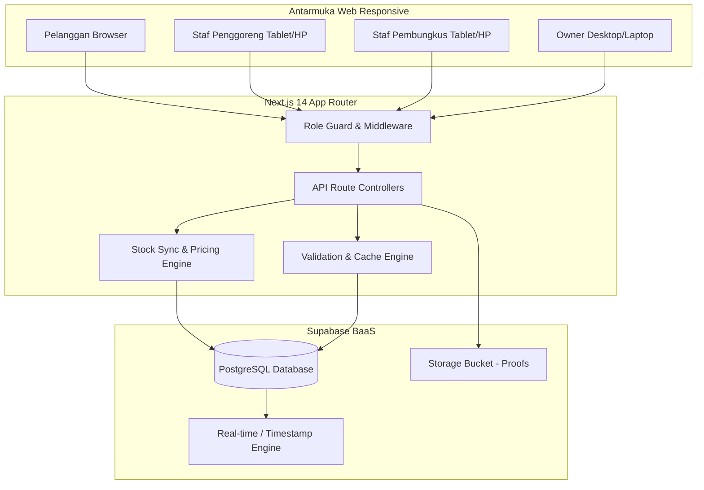
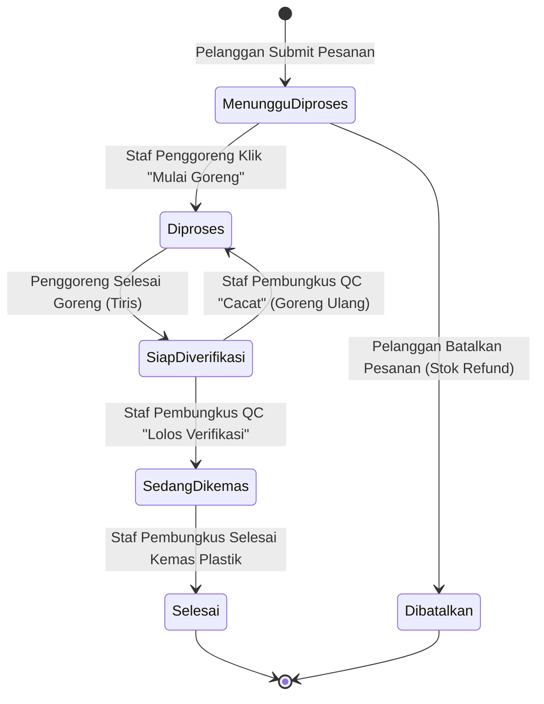

# SPESIFIKASI KEBUTUHAN PERANGKAT LUNAK (SOFTWARE REQUIREMENTS SPECIFICATION - SRS)
## Sistem Informasi Pemesanan dan Manajemen Produksi Kerupuk Berbasis Web (E-KRUPSY)
### Studi Kasus: Pabrik Kerupuk Diansyah — Sumedang

---

| Dokumen | Spesifikasi Kebutuhan Perangkat Lunak (SRS) |
|---|---|
| **Aplikasi** | E-KRUPSY (*Electronic Kerupuk System*) |
| **Instansi / Mitra** | Pabrik Kerupuk Diansyah (Sumedang, Jawa Barat) |
| **Versi Dokumen** | 2.0 (Pemutakhiran Sistem Riil & Sinkron) |
| **Tanggal Pemutakhiran** | 10 November 2026 |
| **Standar Acuan** | IEEE Std 830-1998 / ISO/IEC/IEEE 29148 |
| **Status Dokumen** | Disetujui & Terverifikasi dengan Kode Sumber Sistem |

---

## DAFTAR ISI

- [BAB I: PENDAHULUAN](#bab-i-pendahuluan)
  - [1.1 Tujuan Dokumen](#11-tujuan-dokumen)
  - [1.2 Ruang Lingkup Sistem](#12-ruang-lingkup-sistem)
  - [1.3 Definisi, Akronim, dan Singkatan](#13-definisi-akronim-dan-singkatan)
  - [1.4 Referensi Standar](#14-referensi-standar)
  - [1.5 Gambaran Umum Dokumen](#15-gambaran-umum-dokumen)
- [BAB II: DESKRIPSI UMUM SISTEM](#bab-ii-deskripsi-umum-sistem)
  - [2.1 Perspektif Produk](#21-perspektif-produk)
  - [2.2 Fungsi Utama Perangkat Lunak](#22-fungsi-utama-perangkat-lunak)
  - [2.3 Karakteristik Pengguna & Hak Akses](#23-karakteristik-pengguna--hak-akses)
  - [2.4 Lingkungan Operasional & Batasan](#24-lingkungan-operasional--batasan)
  - [2.5 Asumsi dan Ketergantungan](#25-asumsi-dan-ketergantungan)
- [BAB III: KEBUTUHAN ANTARMUKA EKSTERNAL](#bab-iii-kebutuhan-antarmuka-eksternal)
  - [3.1 Antarmuka Pemakai (User Interface)](#31-antarmuka-pemakai-user-interface)
  - [3.2 Antarmuka Perangkat Keras](#32-antarmuka-perangkat-keras)
  - [3.3 Antarmuka Perangkat Lunak](#33-antarmuka-perangkat-lunak)
  - [3.4 Antarmuka Komunikasi](#34-antarmuka-komunikasi)
- [BAB IV: KEBUTUHAN FUNGSIONAL SISTEM](#bab-iv-kebutuhan-fungsional-sistem)
  - [4.1 Modul 1: Autentikasi, Registrasi, dan RBAC](#41-modul-1-autentikasi-registrasi-dan-rbac)
  - [4.2 Modul 2: Katalog Produk & Keranjang Belanja Multi-Varian](#42-modul-2-katalog-produk--keranjang-belanja-multi-varian)
  - [4.3 Modul 3: Manajemen Transaksi & Multi-Channel Pembayaran](#43-modul-3-manajemen-transaksi--multi-channel-pembayaran)
  - [4.4 Modul 4: Pembatalan Pesanan & Pengembalian Stok Otomatis](#44-modul-4-pembatalan-pesanan--pengembalian-stok-otomatis)
  - [4.5 Modul 5: Alur Kerja Produksi Penggorengan](#45-modul-5-alur-kerja-produksi-penggorengan)
  - [4.6 Modul 6: Pengendalian Mutu (QC) & Pengemasan Plastik](#46-modul-6-pengendalian-mutu-qc--pengemasan-plastik)
  - [4.7 Modul 7: Manajemen Stok Bahan Baku & Sinkronisasi Gudang](#47-modul-7-manajemen-stok-bahan-baku--sinkronisasi-gudang)
  - [4.8 Modul 8: Laporan Keuangan, Analisis Eksekutif, & Cetak Resi](#48-modul-8-laporan-keuangan-analisis-eksekutif--cetak-resi)
  - [4.9 Matriks Keterlacakan Kebutuhan (Traceability Matrix)](#49-matriks-keterlacakan-kebutuhan-traceability-matrix)
- [BAB V: KEBUTUHAN NON-FUNGSIONAL SISTEM](#bab-v-kebutuhan-non-fungsional-sistem)
  - [5.1 Kebutuhan Kinerja (Performance)](#51-kebutuhan-kinerja-performance)
  - [5.2 Kebutuhan Keamanan (Security)](#52-kebutuhan-keamanan-security)
  - [5.3 Kebutuhan Keandalan & Ketersediaan (Reliability & Availability)](#53-kebutuhan-keandalan--ketersediaan-reliability--availability)
  - [5.4 Kebutuhan Kemudahan Penggunaan (Usability)](#54-kebutuhan-kemudahan-penggunaan-usability)
  - [5.5 Kebutuhan Portabilitas](#55-kebutuhan-portabilitas)
- [BAB VI: ATURAN BISNIS (BUSINESS RULES) & FORMULA DOMAIN](#bab-vi-aturan-bisnis-business-rules--formula-domain)
  - [6.1 Matriks Tarif Bumbu Varian Rasa](#61-matriks-tarif-bumbu-varian-rasa)
  - [6.2 Matriks Tarif Ukuran Kemasan Plastik](#62-matriks-tarif-ukuran-kemasan-plastik)
  - [6.3 Formula Perhitungan Keuangan Pabrik](#63-formula-perhitungan-keuangan-pabrik)
  - [6.4 Aturan Transisi State Pesanan & Produksi](#64-aturan-transisi-state-pesanan--produksi)

---

## BAB I: PENDAHULUAN

### 1.1 Tujuan Dokumen
Tujuan dari dokumen Spesifikasi Kebutuhan Perangkat Lunak (*Software Requirements Specification* - SRS) ini adalah mendefinisikan secara menyeluruh, tepat, dan formal seluruh kebutuhan fungsional dan non-fungsional dari sistem informasi **E-KRUPSY** (*Sistem Informasi Pemesanan dan Manajemen Produksi Pabrik Kerupuk Diansyah*). 

Dokumen ini menjadi acuan mutlak bagi perancang sistem, pengembang perangkat lunak, penguji (*QA*), pemilik pabrik (*Owner*), serta penguji akademik untuk memastikan implementasi sistem selaras 100% dengan kebutuhan operasional riil Pabrik Kerupuk Diansyah.

### 1.2 Ruang Lingkup Sistem
Sistem Informasi E-KRUPSY adalah aplikasi berbasis web responsif yang dibangun untuk mengotomatisasi rantai operasional bisnis hulu ke hilir pada Pabrik Kerupuk Diansyah Sumedang, meliputi:
1. Layanan transaksi pemesanan kerupuk oleh pelanggan melalui katalog digital dan keranjang belanja *multi-item* / *multi-varian*.
2. Fleksibilitas pembayaran multi-saluran: Tunai (*Cash on Delivery* / COD di Kasir), QRIS Nasional otomatis, dan Transfer Bank resmi (BCA, Mandiri, BJB) dengan proteksi hak otorisasi tunggal pada Owner.
3. Otomasi alur antrean produksi lantai pabrik (*floor shop*) untuk divisi penggorengan wajan dan divisi pengemasan pembungkusan.
4. Pengendalian mutu terintegrasi (*Quality Control* - QC) sebelum kerupuk diserahkan kepada pemesan.
5. Manajemen inventori bahan baku gudang (kerupuk mentah, bumbu penyedap, plastik kemasan) dengan sinkronisasi otomatis dua arah (*deduction on order* & *refund on cancel*).
6. Analisis keuangan eksekutif harian, mingguan, dan bulanan, serta pencetakan resi transaksi dan laporan laba-rugi berformat resmi A4.

### 1.3 Definisi, Akronim, dan Singkatan
* **SRS**: *Software Requirements Specification* (Spesifikasi Kebutuhan Perangkat Lunak).
* **E-KRUPSY**: *Electronic Kerupuk System* (Nama dagang perangkat lunak).
* **Owner**: Pemilik pabrik sekaligus kasir utama dan penanggung jawab operasional tertinggi (Bapak Diansyah).
* **Bal**: Satuan kemasan grosir kerupuk standar Pabrik Diansyah (1 Bal setara volume karung/plastik standar pabrik).
* **RBAC**: *Role-Based Access Control* (Pengendalian akses berbasis peran).
* **QC**: *Quality Control* (Verifikasi pengujian mutu kerenyahan dan kesesuaian fisik kerupuk).
* **NMID**: *National Merchant Identifier* (Identitas resmi penerbit QRIS pabrik).
* **COD**: *Cash on Delivery* (Pembayaran tunai di tempat/kasir saat serah terima produk).
* **BaaS**: *Backend-as-a-Service* (Layanan infrastruktur backend dan basis data yang disediakan Supabase).

### 1.4 Referensi Standar
1. IEEE Std 830-1998: *IEEE Recommended Practice for Software Requirements Specifications*.
2. ISO/IEC/IEEE 29148:2018: *Systems and software engineering — Life cycle processes — Requirements engineering*.
3. Dokumen SOP Operasional Produksi & Penjualan Pabrik Kerupuk Diansyah (Sumedang, 2026).

### 1.5 Gambaran Umum Dokumen
Dokumen ini disusun dalam enam bab utama: Bab I menyajikan pendahuluan; Bab II menguraikan gambaran umum sistem dan profil pengguna; Bab III menjabarkan kebutuhan antarmuka eksternal; Bab IV mendokumentasikan spesifikasi kebutuhan fungsional secara rinci; Bab V menguraikan kebutuhan non-fungsional; dan Bab VI memaparkan matriks aturan bisnis dan formula keuangan/inventori sistem.

---

## BAB II: DESKRIPSI UMUM SISTEM

### 2.1 Perspektif Produk
Sebelum implementasi E-KRUPSY, pencatatan transaksi di Pabrik Kerupuk Diansyah masih dilakukan secara konvensional (buku nota manual kertas dan pesan WhatsApp tak terstruktur). Hal ini menimbulkan kendala:
* Ketidaksesuaian jumlah gorengan dengan pesanan pelanggan.
* Kesulitan melacak bahan baku (kerupuk mentah, bumbu, plastik) yang terpakai.
* Tidak adanya verifikasi mutu QC tertulis antara staf penggoreng dan staf pembungkus.
* Risiko kebocoran piutang kas pada sistem pembayaran tunai.

E-KRUPSY memposisikan diri sebagai solusi *enterprise resource planning* (ERP) mandiri berbasis web terintegrasi yang menghubungkan 4 peran dalam satu basis data terdistribusi (*cloud database* Supabase PostgreSQL) dengan komunikasi real-time.

### 2.2 Fungsi Utama Perangkat Lunak
Secara ringkas, E-KRUPSY mengemban kemampuan fungsional utama berikut:
1. **Autentikasi Aman & Isolasi Hak Akses**: Otentikasi mandiri untuk pelanggan dan *hardened credentials* untuk staf operasional pabrik.
2. **Katalog Produk Dinamis**: Penayangan ketersediaan stok, harga dasar, deskripsi, gambar, dan rekam jejak jumlah terjual.
3. **Pemesanan Multi-Opsi**: Pemesanan langsung (*Direct Order*) atau gabungan varian dalam keranjang belanja (*Batch Cart Order*).
4. **Pembayaran Terotentikasi Owner**: Pelanggan dapat memilih metode bayar (Tunai, QRIS, Transfer), namun hak pengesahan status `"lunas"` secara hukum operasional dipegang mutlak oleh Owner.
5. **Dapur Penggorengan Terstruktur**: Menampilkan antrean wajan pesanan secara berurutan dengan penanda waktu jam masuk pesanan (*timestamp*).
6. **Inspeksi Kualitas Mutu (QC)**: Verifikasi fisik kerenyahan dan kematangan kerupuk sebelum proses pengemasan akhir.
7. **Sinkronisasi Bahan Otomatis**: Pemotongan dan pengembalian stok bahan mentah gudang secara akurat berdasarkan resep produksi tiap bal kerupuk.
8. **Analisis Finansial & Dokumen Fisik**: Perhitungan laba rugi real-time dan generator resi fisik/tanda lunas digital.

### 2.3 Karakteristik Pengguna & Hak Akses
Sistem mengimplementasikan *Role-Based Access Control* (RBAC) ketat dengan empat kelas aktor:

| Aktor / Peran | Kategori Pengguna | Deskripsi Tugas Operasional | Hak Akses Rute |
|---|---|---|---|
| **Pelanggan** | Eksternal | Melihat katalog, memesan kerupuk, memilih varian/kemasan, membayar via Tunai/QRIS/Transfer, melihat status produksi live, membatalkan pesanan, dan menampilkan Tanda Lunas Digital. | `/dashboard/pelanggan/*` *(Dilarang masuk rute internal)* |
| **Owner** | Internal (Pimpinan) | Memvalidasi penerimaan kas/ACC Lunas, mencetak resi resmi fisik, mengelola katalog dan stok produk, memantau pesanan dibatalkan + kontak WA, dan menganalisis laporan laba rugi pabrik. | `/dashboard/owner/*` |
| **Staf Penggoreng** | Internal (Produksi Dapur) | Mengambil antrean wajan kerupuk, mengubah status penggorengan, melihat instruksi varian rasa dari pesanan, menginput stok bahan mentah/bumbu masuk, serta melihat feedback verifikasi QC. | `/dashboard/staff-penggoreng/*` |
| **Staf Pembungkus** | Internal (QC & Kemas) | Menerima hasil goreng, melakukan uji petik kerenyahan (QC Lolos/Cacat), mengemas kerupuk ke dalam plastik pesanan, mengubah status ke siap diambil, dan mengelola stok plastik. | `/dashboard/staff-pembungkus/*` |

### 2.4 Lingkungan Operasional & Batasan
1. **Sisi Klien**: Dapat diakses melalui peramban web modern (*Google Chrome*, *Mozilla Firefox*, *Safari*, *Microsoft Edge*) pada perangkat Ponsel Pintar, Tablet, maupun Komputer Desktop tanpa memerlukan instalasi aplikasi tambahan (*Zero Client Installation*).
2. **Sisi Server**: Berjalan pada *runtime* Node.js v18.17+ dengan kerangka kerja Next.js 14 (*App Router Architecture*).
3. **Sisi Basis Data**: Menggunakan *Managed Cloud PostgreSQL* dari Supabase dengan koneksi REST API / PostgREST terenkripsi SSL/TLS.
4. **Zona Waktu**: Seluruh penanda tanggal dan jam pada detail pesanan menggunakan standar Waktu Indonesia Barat (**WIB / UTC+7**).
5. **Format Cetak**: Mendukung pencetakan format kertas fisik standar ISO A4 dan kuitansi komersial menggunakan *CSS Print Media Queries*.

### 2.5 Asumsi dan Ketergantungan
1. Perangkat pengguna terhubung ke jaringan internet publik untuk berkomunikasi dengan basis data cloud Supabase.
2. Pabrik Kerupuk Diansyah memiliki rekening bank resmi (BCA, Mandiri, BJB) dan QRIS Merchant aktif a/n Bapak Diansyah.
3. Ketersediaan infrastruktur Supabase BaaS diasumsikan memiliki *Service Level Agreement* (SLA) 99.9%. Bila koneksi terputus sesaat, sistem memiliki *in-memory cache fallback* untuk mempertahankan kestabilan UI.

---

## BAB III: KEBUTUHAN ANTARMUKA EKSTERNAL

### 3.1 Antarmuka Pemakai (User Interface)
1. **Responsivitas Multi-Resolusi**: Antarmuka berbasis Tailwind CSS yang adaptif terhadap resolusi layar *Mobile* (320px–640px), *Tablet* (641px–1024px), dan *Desktop* (1025px+).
2. **Umpan Balik Kondisi Sistem (*Three-State UI Alert*)**:
   - *Loading State*: Tombol dinonaktifkan (*disabled*) dengan spinner animasi saat transaksi dikirim guna mencegah *double submit*.
   - *Success State*: Kartu pemberitahuan warna hijau (*emerald*) dengan ikon `CheckCircle2` ketika data berhasil tersimpan.
   - *Error State*: Kartu pemberitahuan warna merah (*rose*) dengan ikon `AlertCircle` saat terjadi kegagalan validasi atau jaringan dalam Bahasa Indonesia baku.
3. **Komponen Cetak Khusus (*Print Engine*)**: Elemen navigasi web disembunyikan secara otomatis saat mode print aktif (`@media print { .print:hidden { display: none; } }`) dan merender dokumen kertas bergaris, tabel resmi, kop surat, dan kolom tanda tangan basah.

### 3.2 Antarmuka Perangkat Keras
1. Perangkat masukan: Layar sentuh (*touchscreen*) ponsel/tablet atau papan ketik (*keyboard*) dan tetikus (*mouse*).
2. Perangkat keluaran: Layar monitor resolusi minimal 360x640 piksel dan printer laser/inkjet standar untuk cetak resi dan laporan keuangan A4.

### 3.3 Antarmuka Perangkat Lunak
1. **Sistem Operasi**: Kompatibel dengan Windows 10/11, macOS, Linux, Android, dan iOS.
2. **Next.js 14**: Sebagai web server, server-side renderer, dan API handler.
3. **Supabase Client Library (`@supabase/supabase-js`)**: Untuk koneksi database dan sinkronisasi berkas gambar bukti transfer.
4. **Bcrypt.js**: Untuk enkripsi satu arah *password hashing* (10 salt rounds).

### 3.4 Antarmuka Komunikasi
1. Protokol komunikasi client-server: **HTTPS** melalui port 443.
2. Format pertukaran data API: **JSON** (*JavaScript Object Notation*).
3. Mekanisme Sinkronisasi Live: *Silent Background Polling* interval 2.500 ms (2,5 detik) guna memastikan data antrean antar-dashboard terbarui seketika tanpa *flicker* atau reload manual (F5).

---

## BAB IV: KEBUTUHAN FUNGSIONAL SISTEM

Kebutuhan fungsional sistem diberi kodefikasi **SKF** (*Spesifikasi Kebutuhan Fungsional*).

### 4.1 Modul 1: Autentikasi, Registrasi, dan RBAC

* **SKF-01 [Registrasi Akun Pelanggan]**: Sistem harus menyediakan formulir pendaftaran bagi pelanggan baru dengan input: Nama Lengkap, Username, Email, Password, No. HP, Alamat, dan Jenis Kelamin.
* **SKF-02 [Validasi 4 Lapis Pendaftaran]**: Sistem harus menerapkan 4 jenis validasi pada formulir registrasi:
  1. *Existence Check*: Kolom wajib tidak boleh kosong.
  2. *Data Type Check*: No. HP harus bilangan bulat murni (`integer`), diblokir langsung di level pengetikan UI (`onKeyDown`).
  3. *Domain Check*: Password minimal bernilai 6 karakter.
  4. *Format Check*: Email harus berformat standar RFC (`user@domain.com`).
* **SKF-03 [Autentikasi Pengguna & Keamanan Password]**: Sistem harus memverifikasi kredensial login (Username/Email dan Password) menggunakan pencocokan hash `bcrypt.compare`.
* **SKF-04 [Role-Based Access Control / Role Guard]**: Sistem harus mengisolasi rute dashboard sesuai peran akun. Apabila Pelanggan mencoba membuka rute `/dashboard/owner`, `/dashboard/staff-penggoreng`, atau `/dashboard/staff-pembungkus`, sistem harus memblokir akses dan menampilkan pesan error merah serta tombol pengalihan kembali.

### 4.2 Modul 2: Katalog Produk & Keranjang Belanja Multi-Varian

* **SKF-05 [Penayangan Katalog Produk]**: Sistem harus menampilkan daftar produk kerupuk dari basis data mencakup nama produk, gambar, harga dasar per bal, ketersediaan stok, deskripsi tekstur/rasa, dan total bal yang telah terjual.
* **SKF-06 [Kustomisasi Varian Rasa & Ukuran Plastik]**: Sistem harus memungkinkan pemesan memilih varian rasa (Original Gurih, Balado Manis Pedas, Pedas Level 5, Keju Asin Gurih) dan ukuran plastik kemasan (1/2 kg, 1x25 kg, 30x45 kg, 12x22 kg, 12x25 kg) dengan penyesuaian biaya otomatis.
* **SKF-07 [Pemesanan Langsung / Direct Order]**: Sistem harus memfasilitasi pemesanan kilat 1 jenis kerupuk langsung dari modal produk dengan kalkulasi tagihan instan.
* **SKF-08 [Keranjang Belanja Multi-Item / Multi-Varian]**: Sistem harus memungkinkan pelanggan menampung banyak jenis kerupuk dengan kombinasi varian dan kemasan berbeda di dalam keranjang belanja sementara (*Client-Side Cart Storage*).
* **SKF-09 [Manajemen Keranjang]**: Pelanggan dapat menambah kuantitas, mengurangi kuantitas, menghapus salah satu item, atau mengosongkan seluruh keranjang belanja.
* **SKF-10 [Checkout Gabungan Batch Keranjang]**: Sistem harus memproses seluruh item keranjang belanja menjadi **tepat 1 baris pesanan utama** dan **tepat 1 pembayaran gabungan** di database dengan seluruh rincian varian tersimpan rapi dalam format JSON terstruktur.

### 4.3 Modul 3: Manajemen Transaksi & Multi-Channel Pembayaran

* **SKF-11 [Metode Pembayaran Tunai / COD]**: Sistem harus mendukung metode bayar tunai di mana status pembayaran bernilai `"pending"` hingga kas fisik diserahkan kepada kasir pabrik.
* **SKF-12 [Metode Pembayaran QRIS Otomatis]**: Sistem harus menampilkan kode QRIS resmi Pabrik Kerupuk Diansyah lengkap dengan NMID (`ID1025393458506`), panduan scan multi-bank/e-wallet, serta struk digital pembayaran QRIS otomatis.
* **SKF-13 [Metode Pembayaran Transfer Bank Resmi]**: Sistem harus menyajikan nomor rekening resmi Pabrik Kerupuk Diansyah (BCA, Mandiri, BJB) atas nama Bapak Diansyah, tombol salin nomor rekening 1-klik, dan formulir pengunggahan bukti screenshot transfer.
* **SKF-14 [Hak Otorisasi Lunas Tunggal pada Owner]**: Sistem **tidak boleh** membiarkan pelanggan mengubah status pembayaran menjadi lunas sendiri. Hak persetujuan (*ACC Lunas*) hanya dapat dieksekusi oleh Owner melalui dashboard Owner.
* **SKF-15 [Digital Pass / Tanda Lunas Pelanggan]**: Sistem harus menyediakan tampilan *Tanda Lunas Digital* berstempel resmi pada dashboard pelanggan yang hanya dapat dibuka jika pembayaran telah berstatus `"lunas"`, sebagai tanda bukti sah saat mengambil kerupuk di pabrik.

### 4.4 Modul 4: Pembatalan Pesanan & Pengembalian Stok Otomatis

* **SKF-16 [Hak Pembatalan Pelanggan]**: Pelanggan berhak membatalkan pesanannya sendiri secara mandiri jika pesanan masih berada pada status `"menunggu_diproses"` dan pembayaran belum lunas.
* **SKF-17 [Pengembalian Stok Otomatis / Stock Refund]**: Saat pesanan dibatalkan, sistem secara otomatis wajib mengembalikan stok produk katalog dan seluruh bahan baku terkait di gudang (kerupuk mentah, bumbu, plastik) sejumlah kuantitas yang sebelumnya dipotong.
* **SKF-18 [Dashboard Khusus Pembatalan Owner & Kontak WhatsApp]**: Sistem harus menyediakan tab khusus monitoring pesanan dibatalkan di dashboard Owner, yang menampilkan alasan, rincian barang, status pengembalian bahan, dan tombol kontak WhatsApp langsung ke nomor telepon pemesan (`https://wa.me/...`).

### 4.5 Modul 5: Alur Kerja Produksi Penggorengan

* **SKF-19 [Antrean Penggorengan Real-Time]**: Sistem harus menampilkan daftar pekerjaan penggorengan secara terurut berdasarkan pesanan masuk beserta rincian target volume bal dan varian rasa yang diminta.
* **SKF-20 [Penanda Waktu Jam Masuk Pesanan]**: Sistem harus menampilkan jam dan tanggal pemesanan (WIB) pada setiap kartu wajan antrean produksi staf penggoreng.
* **SKF-21 [Pembaruan Status Penggorengan]**: Staf penggoreng dapat menekan tombol **"Mulai Goreng"** (status produksi berubah menjadi `"diproses"`).
* **SKF-22 [Penyelesaian Penggorengan ke QC]**: Setelah kerupuk matang dan ditiriskan, staf menekan **"Selesai Goreng (Kirim ke QC)"** sehingga status produksi beralih menjadi `"siap_diverifikasi"`.

### 4.6 Modul 6: Pengendalian Mutu (QC) & Pengemasan Plastik

* **SKF-23 [Antrean Verifikasi Kualitas Mutu]**: Sistem pada dashboard staf pembungkus harus menampilkan kerupuk yang telah selesai digoreng untuk diuji kelayakan fisiknya.
* **SKF-24 [Formulir Uji Petik QC]**: Staf pembungkus mencatat hasil evaluasi mutu: status kelayakan (*Lolos Verifikasi* atau *Cacat / Tidak Sesuai*) dan catatan kerenyahan/tekstur ke tabel `verifikasi_produksi`.
* **SKF-25 [Transparansi Feedback QC ke Penggoreng]**: Hasil verifikasi QC yang dicatat oleh staf pembungkus harus dapat dibaca secara langsung dan transparan oleh staf penggoreng di dashboardnya.
* **SKF-26 [Penyelesaian Pengemasan & Status Akhir]**: Setelah pengemasan selesai, staf pembungkus menekan tombol **"Selesai Kemas (Siap Diambil)"**, yang otomatis memperbarui status akhir pesanan menjadi `"selesai"`.

### 4.7 Modul 7: Manajemen Stok Bahan Baku & Sinkronisasi Gudang

* **SKF-27 [Pemantauan Stok Gudang 3 Kategori]**: Sistem harus menampilkan ketersediaan stok fisik bahan baku yang terbagi atas: Kerupuk Mentah (Kg), Bumbu Tabur (Kg), dan Plastik Pembungkus (Pack/Bal).
* **SKF-28 [Pemotongan Stok Proporsional Otomatis]**: Setiap terjadi transaksi pemesanan kerupuk baru (baik direct maupun batch keranjang), sistem otomatis menghitung dan memotong kuantitas stok bahan mentah, bumbu rasa, dan plastik di database.
* **SKF-29 [Restock Bahan Baku Masuk]**: Staf dan Owner dapat menambah pasokan bahan baku yang baru tiba dari supplier, dengan pencatatan nama bahan, kuantitas, tanggal update, dan user pencatat.
* **SKF-30 [Sinkronisasi Pasokan ke Produk Katalog]**: Penambahan bahan mentah kerupuk otomatis mengalkulasikan penambahan kuantitas stok bal produk jadi yang siap dijual pada katalog Owner.

### 4.8 Modul 8: Laporan Keuangan, Analisis Eksekutif, & Cetak Resi

* **SKF-31 [Ringkasan Eksekutif Finansial Owner]**: Sistem harus menghitung metrik finansial secara live:
  - Total Omset Penjualan (Gross Revenue).
  - Realisasi Kas Masuk (Total transaksi berstatus `"lunas"`).
  - Piutang Pelanggan (Total transaksi pending).
  - Estimasi Biaya Pokok Produksi / HPP (~70% dari omset).
  - Estimasi Laba Bersih Operasional Pabrik (~30% dari omset).
* **SKF-32 [Grafik Statistik Penjualan Interaktif]**: Sistem menyajikan grafik interaktif dengan filter dinamis: Harian (7 hari terakhir), Mingguan (4 minggu terakhir), dan Bulanan (12 bulan dalam tahun berjalan).
* **SKF-33 [Rekapitulasi Saluran Pembayaran & Kontribusi Varian]**: Sistem menyajikan tabel rekap transaksi berdasarkan metode bayar (Tunai vs QRIS vs Transfer) serta volume penjualan per varian rasa kerupuk.
* **SKF-34 [Pencetakan Resi Fisik Resmi]**: Owner dapat mencetak kuitansi resi transaksi resmi di kertas A4 lengkap dengan identitas pabrik, nomor transaksi unik (`TRX-KD-[ID]`), rincian varian/kemasan, dan paraf kasir.
* **SKF-35 [Pencetakan Laporan Keuangan Resmi Pabrik]**: Owner dapat mengekspor/mencetak dokumen resmi Rekapitulasi Laporan Keuangan Pabrik Kerupuk Diansyah dengan Kop Surat resmi, periode transaksi yang dipilih, dan tanda tangan Owner.

### 4.9 Matriks Keterlacakan Kebutuhan (Traceability Matrix)

| Kode Kebutuhan | Nama Kebutuhan Fungsional | Pelanggan | Owner | Staf Penggoreng | Staf Pembungkus |
|---|---|:---:|:---:|:---:|:---:|
| **SKF-01 - 04** | Registrasi, Login, Validasi & RBAC | ✓ | ✓ | ✓ | ✓ |
| **SKF-05 - 07** | Katalog Produk & Direct Order | ✓ | ✓ | - | - |
| **SKF-08 - 10** | Keranjang Belanja & Checkout Batch | ✓ | - | - | - |
| **SKF-11 - 13** | Pembayaran Tunai, QRIS, & Transfer | ✓ | ✓ | - | - |
| **SKF-14** | Hak Otorisasi Lunas (ACC Kasir) | - | ✓ | - | - |
| **SKF-15** | Digital Pass / Tanda Lunas Sah | ✓ | ✓ | - | - |
| **SKF-16 - 18** | Pembatalan Pesanan & Refund Otomatis | ✓ | ✓ | - | - |
| **SKF-19 - 22** | Antrean & Eksekusi Penggorengan | - | ✓ | ✓ | - |
| **SKF-23 - 26** | Verifikasi Mutu QC & Pengemasan | - | ✓ | - | ✓ |
| **SKF-27 - 30** | Manajemen Stok & Sinkronisasi Bahan | - | ✓ | ✓ | ✓ |
| **SKF-31 - 33** | Laporan Keuangan & Grafik Interaktif | - | ✓ | - | - |
| **SKF-34 - 35** | Cetak Resi Fisik & Laporan Resmi A4 | - | ✓ | - | - |

---

## BAB V: KEBUTUHAN NON-FUNGSIONAL SISTEM

### 5.1 Kebutuhan Kinerja (Performance)
1. **Waktu Respon Halaman**: Waktu pemuatan halaman awal (*Initial Page Load*) tidak boleh melebihi 2 detik pada jaringan 4G/WiFi standar.
2. **Waktu Eksekusi API**: Rata-rata waktu eksekusi endpoint transaksi basis data (Insert/Update) berada di bawah 500 ms.
3. **Optimasi Pemanggilan Latar Belakang**: *Silent Background Polling* berjalan secara asinkron tanpa memblokir interaksi antarmuka pengguna (*non-blocking UI*) dan menggunakan *in-memory caching* jangka pendek (3.000 ms) untuk menghemat kuota transmisi data Supabase.

### 5.2 Kebutuhan Keamanan (Security)
1. **Enkripsi Kata Sandi**: Seluruh kata sandi pengguna wajib dienkripsi searah (*one-way salted hash*) menggunakan algoritma Bcrypt dengan minimal 10 putaran salt sebelum disimpan ke tabel `users`.
2. **Sanitasi Masukan & Proteksi Injeksi**: Semua parameter masukan formulir disaring melalui *Validation Engine* terpusat guna mencegah serangan *Cross-Site Scripting* (XSS) dan *SQL Injection*.
3. **Pemberian Akses Berbasis Token/Sesi**: Validasi sesi di setiap *page load* dashboard memastikan pengguna yang tidak sah dialihkan seketika ke halaman `/login`.

### 5.3 Kebutuhan Keandalan & Ketersediaan (Reliability & Availability)
1. **Ketersediaan Sistem**: Sistem beroperasi 24 jam sehari, 7 hari seminggu (ketersediaan 99,5%).
2. **Kondisi Tanpa Data Hilang**: Transaksi pesanan yang telah dikonfirmasi tersimpan secara permanen (*ACID Compliant*) di PostgreSQL Supabase.
3. **Mekanisme Fallback Lokal**: Sistem dilengkapi kelas *LocalStore* pada memori runtime server sebagai cadangan penampung sesi saat terjadi *cold-start* atau gangguan jaringan sesaat.

### 5.4 Kebutuhan Kemudahan Penggunaan (Usability)
1. **Bahasa Antarmuka**: Seluruh teks instruksi, label formulir, tombol aksi, dan pesan kesalahan disajikan dalam **Bahasa Indonesia penuh** yang komunikatif dan mudah dipahami oleh pekerja pabrik.
2. **Pemberitahuan Interaktif Ramah Pengguna**: Mematikan tooltip bawaan browser berbahasa Inggris dengan atribut `noValidate` dan menggantikannya dengan komponen alert visual berwarna tematik.
3. **Kemudahan Alur Pesanan**: Pelanggan dapat menyelesaikan transaksi pemesanan kerupuk dalam waktu kurang dari 60 detik (3 langkah mudah: Pilih varian & kemasan &rarr; Pilih cara bayar &rarr; Kirim).

### 5.5 Kebutuhan Portabilitas
Aplikasi bersifat sepenuhnya berbasis web (*Pure Web Application*) yang tidak mensyaratkan dependensi *native library* pada perangkat pengguna, sehingga dapat dijalankan pada seluruh sistem operasi desktop dan mobile modern.

---

## BAB VI: ATURAN BISNIS (BUSINESS RULES) & FORMULA DOMAIN

### 6.1 Matriks Tarif Bumbu Varian Rasa
Pabrik Kerupuk Diansyah menerapkan matriks tarif resmi tambahan bumbu per bal kerupuk:

| No | Varian Rasa Resmi | Kategori Rasa | Biaya Tambahan Bumbu (per Bal) |
|---|---|---|---|
| 1 | **Original Gurih** | Asin Bawang Gurih Klasik | **+Rp 50.000** |
| 2 | **Balado Manis Pedas** | Cabai Merah & Rempah Manis | **+Rp 40.000** |
| 3 | **Pedas Level 5** | Ekstra Cabai Rawit Kering Super Pedas | **+Rp 50.000** |
| 4 | **Keju Asin Gurih** | Serbuk Keju Cheddar Gurih | **+Rp 36.000** |

### 6.2 Matriks Tarif Ukuran Kemasan Plastik
Pabrik Kerupuk Diansyah menerapkan biaya kemasan plastik pembungkus standar per bal:

| No | Pilihan Ukuran Kemasan Plastik | Ketebalan / Tipe | Biaya Kemasan Plastik (per Bal) |
|---|---|---|---|
| 1 | **Kemasan Plastik 1/2 kg** | Plastik Bening PP Standar | **+Rp 34.000** |
| 2 | **Kemasan Plastik 1x25 kg** | Plastik Tebal Sedang | **+Rp 34.000** |
| 3 | **Kemasan Karung 30x45 kg** | Karung Anyam Pabrik Besar | **+Rp 34.000** |
| 4 | **Kemasan Plastik 12x22 kg** | Plastik Khusus Pengecer | **+Rp 34.000** |
| 5 | **Kemasan Plastik 12x25 kg** | Plastik Roll Tebal | **+Rp 34.000** |

> **Formula Harga Akhir Item Kerupuk**:  
> $$\text{Harga Per Bal} = \text{Harga Dasar Produk} + \text{Biaya Bumbu} + \text{Biaya Plastik}$$  
> $$\text{Subtotal Tagihan} = \text{Harga Per Bal} \times \text{Jumlah Pesanan (Qty Bal)}$$

### 6.3 Formula Perhitungan Keuangan Pabrik
Perhitungan finansial eksekutif pada laporan Owner diatur dengan aturan bisnis:
1. **Total Omset Penjualan**: Akumulasi nilai `total_harga` dari seluruh pesanan yang **tidak dibatalkan** (`status_pesanan != 'dibatalkan'`).
2. **Total Kas Masuk**: Akumulasi pembayaran dengan status terverifikasi `"lunas"` (`status_pembayaran = 'lunas'`).
3. **Total Piutang**: Akumulasi pembayaran yang masih pending (`status_pembayaran = 'pending'`).
4. **Estimasi HPP Pabrik**: Ditaksir sebesar **70%** dari total omset (mencakup biaya bahan mentah kerupuk, minyak goreng, bumbu, plastik, dan upah tenaga kerja).  
   $$\text{HPP} = 0.70 \times \text{Total Omset}$$
5. **Estimasi Laba Bersih Pabrik**: Ditaksir sebesar **30%** dari total omset penjualan.  
   $$\text{Laba Bersih} = 0.30 \times \text{Total Omset}$$

### 6.4 Aturan Transisi State Pesanan & Produksi

Aturan Status Pembayaran (*Payment Lifecycle*):
- Status awal pesanan baru: `"pending"`.
- Jika metode QRIS dan scan berhasil: status tercatat berbayar.
- Persetujuan akhir mutlak dilakukan melalui tombol **"ACC Lunas"** oleh Owner &rarr; status berubah menjadi `"lunas"`.

---
*Dokumen Spesifikasi Kebutuhan Perangkat Lunak (SRS) ini dibuat dan disahkan sebagai acuan baku pengembangan Sistem Informasi E-KRUPSY Pabrik Kerupuk Diansyah.*
