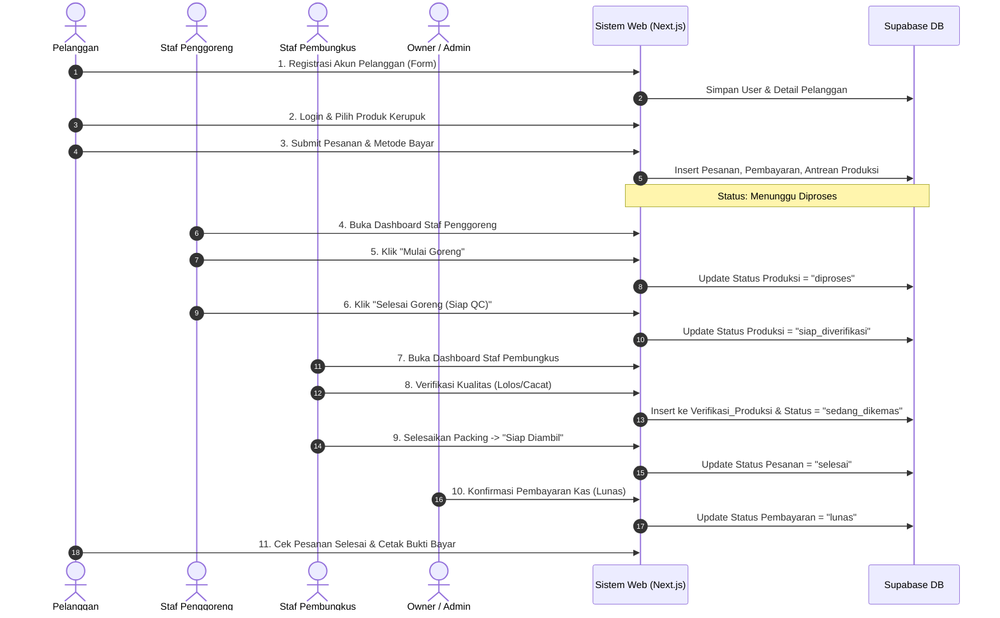

# Alur Kerja End-to-End Sistem E-KRUPSY

Dokumen ini menjelaskan alur operasional terintegrasi dari awal pemesanan oleh pelanggan hingga penyerahan produk dan pelaporan keuangan di Pabrik Kerupuk Diansyah.

---

## Diagram Alur Kerja (Workflow)

---

## Rincian Tiap Tahapan:

### Tahap 1: Registrasi & Pemesanan (Pelanggan)
1. **Registrasi Akun Baru**: Pelanggan mengisi formulir di `/register` (Nama, Username, Email, Password, Telepon, Alamat).
2. **Katalog Produk**: Pelanggan melihat daftar produk kerupuk dari Supabase.
3. **Form Pemesanan Mandiri**: Pelanggan memilih varian rasa, kemasan plastik, jumlah pesanan, dan metode pembayaran.
4. **Validasi**: Sistem menjalankan 4 lapis validasi data sebelum data dikirim ke database.
5. **Pencatatan Otomatis**: Pesanan disimpan ke tabel `pesanan`, transaksi pembayaran ke tabel `pembayaran`, dan otomatis dibuat entri antrean baru di tabel `produksi`.

### Tahap 2: Penggorengan & Pengolahan Bahan (Staf Penggoreng)
1. Staf Penggoreng masuk menggunakan akun `penggoreng` / `goreng123`.
2. Sistem menampilkan antrean wajan penggorengan.
3. Staf menekan tombol **"Mulai Goreng"** &rarr; status produksi berubah menjadi `diproses` (Sedang Digoreng).
4. Setelah kerupuk matang dan tiris, staf menekan **"Selesai Goreng (Kirim ke QC)"** &rarr; status berubah menjadi `siap_diverifikasi`.
5. Staf juga dapat mencatat pasokan bahan baku yang masuk ke gudang (kerupuk mentah, bumbu, minyak).

### Tahap 3: Verifikasi Mutu & Pengemasan (Staf Pembungkus)
1. Staf Pembungkus masuk menggunakan akun `pembungkus` / `bungkus123`.
2. Sistem menampilkan daftar kerupuk yang telah matang dan menunggu verifikasi.
3. Staf membuka tombol **"Verifikasi Kualitas (QC)"** untuk mencatat kerenyahan dan kesesuaian fisik &rarr; data tercatat di tabel `verifikasi_produksi`.
4. Jika lolos verifikasi, status beralih menjadi `sedang_dikemas`.
5. Staf melakukan pengemasan dengan plastik sesuai permintaan pemesan, lalu menekan **"Selesai Kemas (Siap Diambil)"** &rarr; status akhir pesanan menjadi `selesai`.

### Tahap 4: Pembayaran & Pelaporan (Owner)
1. Owner masuk menggunakan akun `owner` / `owner123`.
2. Dashboard Owner menampilkan ringkasan metrik omset penjualan, jumlah transaksi, dan laba bersih secara real-time.
3. Pada tabel transaksi, Owner dapat mengonfirmasi pelunasan pembayaran kas (*Cash on Delivery*) dengan mengklik **"Konfirmasi Lunas"**.
4. Owner dapat menambahkan varian produk baru ke katalog dan mencetak rekapitulasi laporan harian.

### Tahap 5: Pengambilan & Cetak Bukti Bayar (Pelanggan)
1. Pelanggan membuka tab "Pesanan Saya" di dashboard pelanggan.
2. Pesanan telah berstatus **"Siap Diambil / Selesai"** dan berstatus **"LUNAS"**.
3. Pelanggan dapat menekan tombol **"Lihat Bukti Bayar / Resi"** dan mencetak kuitansi resmi digital Pabrik Kerupuk Diansyah.
